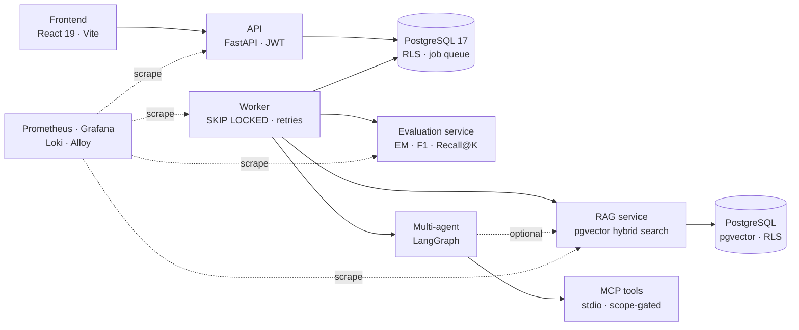

# ATLAS — AI Platform Reference Workspace

ATLAS is a local-first reference platform for **tenant-isolated AI workloads**: authenticated inference jobs, retrieval-augmented generation (RAG) with citations, answer and retrieval evaluation, a LangGraph multi-agent workflow that calls real MCP tools, and full observability with Prometheus, Grafana and Loki.

This repository is the **entry point**. It pins the six component repositories as Git submodules, so a single clone gives you the folder layout the integrated Docker Compose stack expects.

> **Portfolio / reference project — not production-ready.** Local development uses demonstration credentials and shared-secret JWTs. AWS/Terraform is a documented scaffold and is **not deployed**.

## Architecture



The frontend only talks to the public API. RAG, evaluation and agent services are private and reached by the worker with per-service keys. Tenant identity always comes from the validated JWT, and PostgreSQL row-level security enforces it.

## Repositories

| Repository | Role | Stack |
|---|---|---|
| [ai-inference-platform](https://github.com/jcastellobranco/ai-inference-platform) | **Integrator.** Public API, durable worker, React frontend, Compose stack, `make` golden paths, service generator CLI | FastAPI, PostgreSQL 17 RLS, React 19 |
| [rag-document-intelligence](https://github.com/jcastellobranco/rag-document-intelligence) | Document ingestion (text/PDF) and tenant-scoped hybrid retrieval with chunk citations | pgvector, FTS + cosine + RRF, sentence-transformers |
| [llm-evaluation-observability](https://github.com/jcastellobranco/llm-evaluation-observability) | Evaluation API (exact match, token F1, Recall/MRR/Precision@K, release gates) and the Prometheus/Grafana/Loki/alert configuration | FastAPI, Prometheus, Grafana |
| [multi-agent-orchestration](https://github.com/jcastellobranco/multi-agent-orchestration) | Deterministic LangGraph workflow with guardrails, optional RAG adapter, Redis planner cache and per-stage traces | LangGraph, FastAPI, Redis |
| [mcp-tool-platform](https://github.com/jcastellobranco/mcp-tool-platform) | Model Context Protocol tool server with deny-by-default scopes and bounded inputs | MCP Python SDK (FastMCP, stdio) |
| [atlas-infrastructure](https://github.com/jcastellobranco/atlas-infrastructure) | AWS reference scaffold (ECS Fargate, RDS, ALB, ECR) plus an independent low-cost EC2 demo profile | Terraform, GitHub Actions |

Each repository has its own README, tests and CI. Start there for component details.

## Quick start (local, no cloud)

Requirements: Git, Docker with Compose v2, GNU Make, Python 3.11+.

```bash
git clone --recurse-submodules git@github.com:jcastellobranco/ATLAS.git
cd ATLAS/ai-inference-platform

make doctor              # check prerequisites and sibling repositories
make init                # create .env and local secrets (never committed)
make up-observability    # full stack: API, worker, frontend, RAG, evaluation, agent, MCP, Redis, Grafana

make smoke-rag           # ingest -> job -> worker -> retrieval -> evaluation
make smoke-agent         # JWT -> queue -> worker -> multi-agent -> MCP tool
make smoke-observability # Grafana healthy, all Prometheus targets up
make smoke-alerts        # four Grafana alert rules provisioned
```

Then open:

- Frontend — http://localhost:8080
- Grafana — http://127.0.0.1:3000 (credentials in `ai-inference-platform/.env`)
- Prometheus — http://127.0.0.1:9090

Stop with `make stop-observability` (pause) or `make down-observability` (remove containers, **keep** volumes). Smaller stacks are available: `make up`, `make up-rag`, `make up-agent`, `make up-redis`. LLM generation is off by default. Set `RAG_GENERATION_ENABLED=true` and an OpenAI-compatible key in `.env` to turn it on.

## Working with the submodules

```bash
make update   # pull this repo, then fast-forward every component to its latest main
make status   # branch, ahead/behind and local changes for every component
```

- Submodules are pinned to specific commits. After `make update`, commit the new pointers here (`git commit -am "chore: bump components"`) so the workspace records a known-good combination.
- Submodule checkouts start in detached HEAD. Run `git switch main` inside a component before committing to it, then push from that component as usual.
- Already cloned without submodules? Run `git submodule update --init`.

## Further reading

- [Local-first operating guide](ai-inference-platform/docs/LOCAL_FIRST_ATLAS.md)
- [Integrated local demo](ai-inference-platform/docs/INTEGRATED_LOCAL_DEMO.md)
- [Agent integration](ai-inference-platform/docs/AGENT_INTEGRATION.md)
- [Observability](ai-inference-platform/docs/OBSERVABILITY.md)
- [Security](ai-inference-platform/docs/SECURITY.md)
- [Developer experience and `atlas create-service`](ai-inference-platform/docs/DEVELOPER_EXPERIENCE.md)
